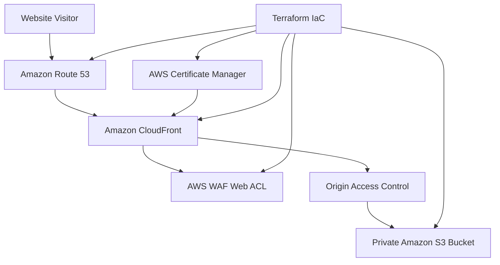

# AWS React Portfolio — Infrastructure as Code with Terraform

## 1. Project Overview

This project provisions and manages the AWS infrastructure required to host a React portfolio website using Terraform.

The infrastructure follows a modular IaC approach, separating AWS resources into reusable Terraform modules. It provides static website hosting, HTTPS, custom domain routing, caching, and web application firewall protection.

**Live website:** https://karthikkunchala.cloudlearningtraining.com

**Root domain:** https://cloudlearningtraining.com

## 2. Architecture



### AWS services

| Service | Purpose |
|---|---|
| Amazon S3 | Stores the React production build |
| Amazon CloudFront | Distributes website content globally over HTTPS |
| Origin Access Control (OAC) | Allows CloudFront to access the private S3 origin |
| AWS Certificate Manager (ACM) | Provides the TLS certificate for the custom domain |
| Amazon Route 53 | Maps the custom domain and portfolio subdomain to CloudFront |
| AWS WAF | Evaluates incoming web requests against configured security rules |
| Terraform | Provisions and manages infrastructure as code |

### AWS regions

- **Primary infrastructure:** `ap-south-1` (Asia Pacific — Mumbai)
- **CloudFront ACM certificate and CloudFront-scoped WAF:** `us-east-1` (US East — N. Virginia)

CloudFront is a global service, but its ACM certificate and CloudFront-scoped WAF resources must use the required US East region.

## 3. Repository Structure

A suggested repository layout is:

```text
portfolio-infra/
├── .github/
│      └──workflows/
│         ├──terraform.yaml
├── terraform/
│   └── dev/
│       ├── data.tf
│       ├── main.tf
│       ├── providers.tf
│       ├── variables.tf
│       ├── outputs.tf
│       └── s3_static_web.tf
├── modules/
│   ├── s3_origin/
│   │   ├── main.tf
│   │   ├── variables.tf
│   │   └── outputs.tf
│   ├── acm/
│   │   ├── main.tf
│   │   ├── variables.tf
│   │   └── outputs.tf
│   ├── cloudfront/
│   │   ├── main.tf
│   │   ├── variables.tf
│   │   └── outputs.tf
│   └── waf/
│       ├── main.tf
│       ├── variables.tf
│       └── outputs.tf
└── README.md
```

The layout is illustrative; keep your existing directory structure if it differs. Route 53 resources can be defined in the root module or a separate reusable module.

## 4. Terraform Provider Configuration

The primary provider manages resources in Mumbai, while an aliased provider manages CloudFront-related regional resources in N. Virginia.

```hcl
provider "aws" {
  region = "ap-south-1"
}

provider "aws" {
  alias  = "us_east_1"
  region = "us-east-1"
}
```

Pass the aliased provider to the ACM and WAF modules:

```hcl
module "acm" {
  source = "../../../modules/acm"

  providers = {
    aws          = aws
    aws.us_east_1 = aws.us_east_1
  }

  root_domain_name          = "cloudlearningtraining.com"
  subject_alternative_names = ["*.cloudlearningtraining.com"]
}
```

The ACM module must declare the `aws.us_east_1` provider alias in its `required_providers` configuration and use it consistently for both the certificate and certificate validation resources.

The Route 53 validation records must use the provider associated with the public hosted zone.

## 5. S3 Static Website Origin

The S3 module provisions a bucket to store the React application's production build.

Example root module configuration:

```hcl
module "s3_static_web_bucket" {
  source      = "../../../modules/s3_origin"
  bucket_name = "${var.project_name}-${var.environment}-static-web-23"

  force_destroy      = false
  enable_replication = false
  enable_lifecycle   = true

  acl             = "private"
  object_ownership = "BucketOwnerPreferred"
  version_status   = "Enabled"

  life_cycle_rules = {
    move_to_glacier = {
      id              = "move_to_glacier"
      status          = "Enabled"
      prefix          = "app/"
      noncurrent_days = 30
      storage_class   = "GLACIER"
      transition_days = 7
    }
  }
}
```

The deployed bucket is:

`karthik-portfolio-dev-static-web-23`

### S3 security

- Keep the bucket private.
- Use CloudFront Origin Access Control to access the S3 REST origin.
- Allow `s3:GetObject` only to the intended CloudFront distribution through its origin access policy.
- Enable versioning if historical object recovery is required.
- Use lifecycle rules only where their retention and transition behavior is intentional.

**Lifecycle consideration:** the example rule targets noncurrent versions under `app/`. The React build is deployed at the bucket root, so confirm the rule still matches your intended objects. Glacier transitions can delay retrieval of older versions and should not be used for current website assets.

## 6. ACM Certificate and DNS Validation

ACM provisions a certificate for the root domain and its wildcard subdomains:

```hcl
module "acm" {
  source = "../../../modules/acm"

  root_domain_name          = "cloudlearningtraining.com"
  subject_alternative_names = ["*.cloudlearningtraining.com"]
}
```

The module should:

1. Request the certificate using DNS validation.
2. Create the required ACM validation CNAME records in the Route 53 public hosted zone.
3. Wait for certificate validation.
4. Export the certificate ARN for CloudFront.

The wildcard certificate covers `karthikkunchala.cloudlearningtraining.com`, but it does not cover the root domain by itself. Including the root domain separately, as above, is therefore important.

CloudFront must use the certificate issued in `us-east-1`. The certificate status should be `ISSUED` before the distribution is expected to serve HTTPS successfully.

## 7. CloudFront Distribution

The CloudFront module serves the private S3 origin and enables HTTPS for the portfolio subdomain.

Example root module configuration:

```hcl
module "cloudfront" {
  source = "../../../modules/cloudfront"

  project_name = "karthik-portfolio"
  environment  = "prod"

  s3_bucket_id                   = module.s3_static_web_bucket.bucket_id
  s3_bucket_regional_domain_name = module.s3_static_web_bucket.bucket_regional_domain_name

  aliases = [
    "karthikkunchala.cloudlearningtraining.com"
  ]

  acm_certificate_arn = module.acm.certificate_arn

  web_acl_arn         = module.waf.web_acl_arn
  enable_spa_fallback = false

  tags = {
    Owner = "portfolio"
  }
}
```

The `web_acl_arn` argument is applicable if the CloudFront module exposes that variable and attaches it to the distribution.

### CloudFront configuration requirements

- Use the S3 REST endpoint rather than an S3 website endpoint when using OAC.
- Redirect viewer HTTP requests to HTTPS.
- Configure `index.html` as the default root object.
- Use the ACM certificate that covers the configured aliases.
- Attach the WAF Web ACL ARN if WAF is enabled.
- Configure cache policies appropriate for HTML and versioned assets.
- Keep SPA fallback disabled for a simple static site unless client-side routing requires it.

### CloudFront plan and cost

The CloudFront distribution's plan selection is separate from the `price_class` setting in a traditional distribution configuration. A price class controls edge location coverage; it does not itself select a flat-rate Free plan.

Verify the selected plan and Terraform provider compatibility before applying changes. Do not assume that a Terraform-created distribution automatically receives the same plan as a manually created distribution.

## 8. Route 53 DNS Records

The public hosted zone for `cloudlearningtraining.com` already exists.

Terraform should create an alias record for the portfolio subdomain that targets the CloudFront distribution.

Example:

```hcl
data "aws_route53_zone" "my_domain" {
  name         = "cloudlearningtraining.com"
  private_zone = false
}

resource "aws_route53_record" "cloudfront_a" {
  zone_id = data.aws_route53_zone.my_domain.zone_id
  name    = "karthikkunchala.cloudlearningtraining.com"
  type    = "A"

  alias {
    name                   = module.cloudfront.distribution_domain_name
    zone_id                = module.cloudfront.distribution_hosted_zone_id
    evaluate_target_health = false
  }
}
```

The CloudFront module must export the distribution domain name and hosted zone ID using the output names shown above, or the references should be adjusted to match the module's actual outputs.

Create an `AAAA` alias record as well if IPv6 access is desired.

**Important:** the DNS record, CloudFront alternate domain name, and certificate must all refer to the same hostname. Avoid duplicate records if the record already exists; import it into Terraform state or manage it through its existing resource.

## 9. AWS WAF Security Configuration

The WAF module creates a CloudFront-scoped Web ACL in `us-east-1`.

Recommended baseline rules:

| Rule | Purpose | Initial behavior |
|---|---|---|
| AWS Managed Common Rule Set | Detects common web exploits | Count, then tune |
| AWS Managed Amazon IP Reputation List | Detects known malicious IP addresses | Block |
| Rate-based rule | Limits excessive requests per source IP | Tune and monitor |
| AWS Managed Known Bad Inputs | Additional malicious input detection | Optional |

Example WAF module invocation:

```hcl
module "waf" {
  source = "../../../modules/waf"

  providers = {
    aws.us_east_1 = aws.us_east_1
  }

  project_name = "karthik-portfolio"
  environment  = "prod"
  rate_limit   = 300

  tags = {
    Owner = "portfolio"
  }
}
```

The module should export `web_acl_arn`, which is passed into the CloudFront module.

### WAF operational considerations

- Start managed rules in Count mode where appropriate to identify false positives.
- Review CloudWatch metrics and sampled requests before enforcing blocking.
- Tune rate limits to normal website traffic.
- Test the portfolio after enabling each rule.
- Check AWS WAF pricing before deployment. WAF can incur separate charges for Web ACLs, rules, and requests; do not assume it is included in the CloudFront Free plan.

## 10. Deploying the React Application

Build the React application locally:

```bash
npm install
npm run build
```

For a Vite application, the output is typically written to `dist/`.

Upload the contents of `dist/` to the S3 bucket root:

```bash
aws s3 sync dist/ s3://karthik-portfolio-dev-static-web-23/
```

This produces the expected structure:

```text
s3://karthik-portfolio-dev-static-web-23/
├── index.html
└── assets/
    ├── index-<hash>.js
    └── index-<hash>.css
```

Ensure the generated HTML references `/assets/...` if the app is hosted at the domain root. Avoid unintentionally uploading the files only under `app/`, which can cause asset path mismatches.

After deployment, invalidate CloudFront's cached HTML if necessary. For example:

```bash
aws cloudfront create-invalidation \
  --distribution-id YOUR_DISTRIBUTION_ID \
  --paths "/" "/index.html"
```

Use the actual distribution ID from your deployment. Hashed JavaScript and CSS assets usually do not need invalidation when each build generates new filenames.

## 11. Terraform Deployment Workflow

Run these commands from the environment's Terraform root directory:

### Format

```bash
terraform fmt -recursive
```

### Initialize

```bash
terraform init
```

### Validate

```bash
terraform validate
```

### Review the plan

```bash
terraform plan
```

Review resource creation, replacement, and deletion carefully. Confirm that the plan uses the intended regions, certificate, distribution aliases, WAF ARN, and hosted zone.

### Apply

```bash
terraform apply
```

Confirm the proposed changes before Terraform proceeds.

### Verify state

```bash
terraform state list
```

Use Terraform state as the record of resources managed by the configuration. If a resource was manually deleted from AWS, inspect its state and the plan before making further changes. Do not remove state entries or delete resources blindly.

## 12. Validation and Troubleshooting

### DNS resolution

```bash
dig cloudlearningtraining.com A
dig karthikkunchala.cloudlearningtraining.com A
```

### HTTPS response

```bash
curl -I https://cloudlearningtraining.com
curl -I https://karthikkunchala.cloudlearningtraining.com
```

### Check S3 objects

```bash
aws s3 ls s3://karthik-portfolio-dev-static-web-23/ --recursive
```

### Check ACM status

```bash
aws acm describe-certificate \
  --region us-east-1 \
  --certificate-arn YOUR_CERTIFICATE_ARN \
  --query 'Certificate.Status' \
  --output text
```

Expected certificate status:

```text
ISSUED
```

### Common issues resolved during implementation

**1. ACM certificate validation could not find the certificate**

The certificate validation resource was missing the correct provider configuration. The certificate and its validation resource must use the same intended `us-east-1` provider.

**2. React build files were stored under the wrong prefix**

The application files were initially under `app/`, while the generated HTML referenced root-relative `/assets/...` paths. Deploying the contents of `dist/` to the bucket root resolved the path mismatch.

**3. CloudFront returned an empty directory response**

The S3 directory marker was not a usable homepage. Setting the CloudFront default root object to `index.html` resolved the root request.

**4. CloudFront returned 403 for the homepage**

The root request failed before the default root object was configured correctly. Verify the default root object, origin path, OAC, and S3 bucket policy if this recurs.

**5. Custom-domain DNS resolution failed intermittently**

Public resolvers and Route 53's authoritative nameservers returned valid answers. Comparing resolver results and testing the domain with `dig` and `curl` helped distinguish DNS resolution from CloudFront configuration.

## 13. Security and Cost Considerations

- Keep the S3 bucket private.
- Restrict S3 object access to CloudFront OAC.
- Use HTTPS and a valid ACM certificate.
- Use least-privilege IAM permissions for Terraform deployment.
- Protect Terraform state, which may contain sensitive infrastructure data.
- Review CloudFront, Route 53, S3, ACM, and WAF pricing independently.
- Verify the CloudFront Free plan's current limits and features before applying infrastructure changes.
- Avoid storing credentials or secrets in Terraform files or source control.
- Review `terraform plan` before every production deployment.

## 14. Future Improvements

Potential extensions to the project include:

- GitHub Actions for automated React builds and S3 deployments.
- Terraform plan checks and approval before infrastructure changes.
- CloudFront invalidation after successful deployment.
- WAF logging and CloudWatch dashboards.
- Separate development and production environments.
- Automated security and dependency scanning.
- Monitoring and alerting for failed deployments and website availability.

## Conclusion

This project demonstrates modular Terraform-based AWS infrastructure management for a React portfolio. It combines private S3 storage, CloudFront content delivery, ACM certificate management, Route 53 DNS, and WAF security controls.

The resulting architecture provides a practical example of Infrastructure as Code, cloud networking, HTTPS configuration, edge delivery, and security automation.